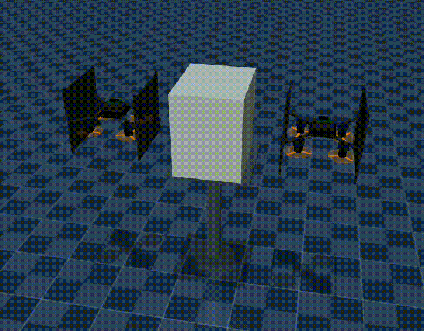

# Hand-in-Hand Simulation 



HIH_sim is a ROS 2 and MuJoCo simulator for cooperative payload transport by two tilting-rotor UAVs. A **Leader** and a **Follower** press against opposite sides of a shared payload, estimate contact wrenches, and move the payload through physical contact in a shared MuJoCo world.

## 1. Install and build

Reference environment:

- Ubuntu 22.04
- ROS 2 Humble
- Python 3.10
- C++17 compiler
- MuJoCo 3.3.7
- Eigen3, NumPy, PyQt5, pyqtgraph, `rosdep`, and `colcon`

Clone the repository and enter the workspace:

```bash
git clone https://github.com/INTGER-PARK/HIH_sim.git
cd HIH_sim
```

Install the non-ROS Python dependency and the dependencies declared by the ROS packages, then build the workspace:

```bash
source /opt/ros/humble/setup.bash
python3 -m pip install --user "mujoco==3.3.7"
rosdep install --from-paths src --ignore-src -r -y
colcon build --symlink-install
source install/setup.bash
```

Source ROS 2 and the workspace in every new terminal:

```bash
source /opt/ros/humble/setup.bash
source install/setup.bash
```

All commands below assume that the current directory is the `HIH_sim` workspace root.

## 2. Run the simulation

Use two terminals for a standard recorded run.

Terminal 1 — start the simulator and recorder:

```bash
source /opt/ros/humble/setup.bash
source install/setup.bash
ros2 launch hih_cmd cooperation_launch.py
```

Terminal 2 — start the Leader trajectory interface:

```bash
source /opt/ros/humble/setup.bash
source install/setup.bash
ros2 run hih_cmd hih_trajectory
```

Keep the input focus in Terminal 2 and use the following keys:

| Key | Action |
|---|---|
| `a` | Start the approach, preload, and lift sequence; also enable Follower admittance |
| `l` | Start an XY Lissajous path from the current measured position |
| `t` | Start a back-and-forth World-X path |
| `r` | Start a rectangular World-YZ path |
| same path key again | Smoothly return to the position captured when the path started |

The Leader trajectory interface takes priority over Leader teleoperation while it owns the command. Returning from a path does not automatically disable Follower admittance.

When the experiment is finished, press `Ctrl+C` in Terminal 1 and wait for both messages before closing the terminal:

```text
Bag finalized: ...
CSV converted from bag: ...
```

Each run is stored under `src/hih_logging/recordings/run_<timestamp>/`. See [`src/hih_logging/README.md`](src/hih_logging/README.md) for rosbag recovery, CSV conversion, and MATLAB instructions.

## 3. System architecture

The normal closed-loop path is:

```text
teleop or trajectory
        |
        | position / attitude reference
        v
Leader/Follower wrench controller  <--- optional admittance, CoP, and DoB offsets
        |
        | desired Body-frame wrench
        v
sequential control allocator
        |
        | four motor speeds + four servo angles
        v
shared MuJoCo plant
        |
        +-- state --------------------------> wrench controller / allocator
        +-- synchronized state + actuation -> momentum observer
        +-- contact and payload telemetry --> logger / plots / optional controllers
```

### Packages

| Package | Responsibility | Start here when changing... |
|---|---|---|
| `hih_cmd` | system launch, keyboard teleoperation, Leader trajectories, and direct external-wrench commands | experiment sequences or operator input |
| `hih_controller` | wrench control, sequential control allocation, momentum observers, admittance, CoP correction, and torque DoB | control laws, gains, limits, or optional feedback |
| `hih_logging` | topic registry, rosbag recording, and wide-CSV conversion | recorded signals or data export |
| `hih_plant` | MuJoCo world, dynamics, disturbances, sensors, and live plots | the physical model; otherwise leave stable |
| `hih_interfaces` | custom ROS 2 message definitions | the public message contract; otherwise leave stable |
| `matlabscripts` | offline plots for a recorded CSV | analysis and figures |

### Manual teleoperation

Run the keyboard node in a separate, focused terminal:

```bash
ros2 run hih_cmd hih_teleop
```

| Vehicle | Horizontal motion | Height | Yaw |
|---|---|---|---|
| Follower | `a/d`: −x/+x, `w/s`: −y/+y | `r/f`: +z/−z | `q/e` |
| Leader | `j/l`: +x/−x, `i/k`: −y/+y | `y/h`: +z/−z | `u/o` |

Horizontal commands follow each vehicle's yaw; height uses World Z. To control only the Leader, run:

```bash
ros2 run hih_cmd hih_teleop_leader
```

### Disturbances and live plots

Run each optional tool in a separately sourced terminal:

```bash
ros2 run hih_plant hih_payload_disturbance \
  --ros-args --params-file src/hih_plant/config/disturbances.yaml

ros2 run hih_plant hih_wind_disturbance \
  --ros-args --params-file src/hih_plant/config/disturbances.yaml

ros2 run hih_plant hih_topic_plot
ros2 run hih_plant hih_external_wrench_plot
```

The disturbance nodes start disabled. The payload node prints its force, moment, and center-of-mass controls at startup; press `w` in the wind node terminal to toggle wind.
